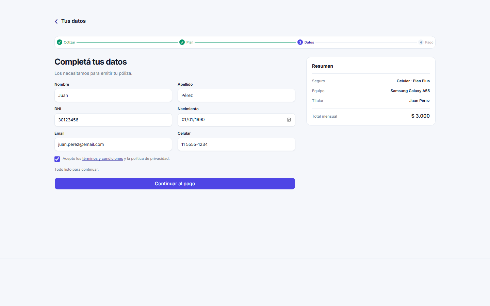
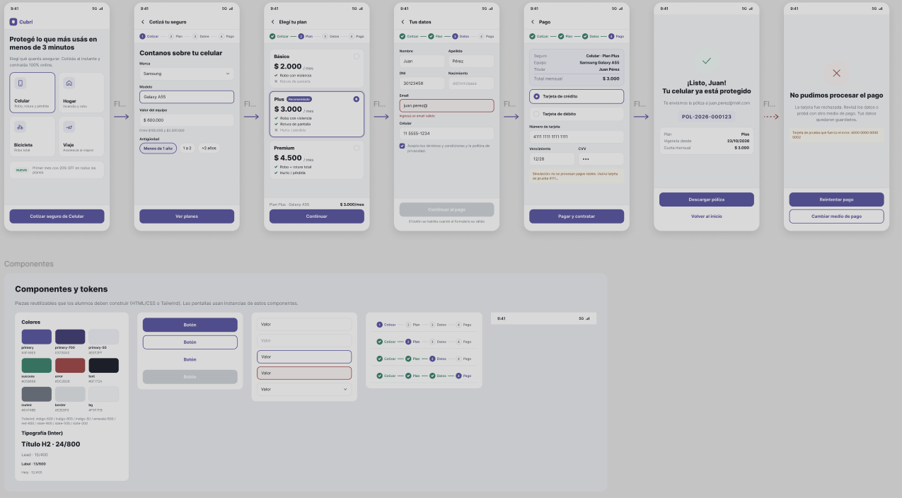

# TP5 — Contratación Digital de Seguros

Prototipo responsive de contratación de seguro para celular. Incluye catálogo, cotización, selección de planes, datos personales, pago simulado y resultados de aprobación o rechazo. No hay backend ni cobro real.

## Tecnologías

- HTML5 semántico.
- Tailwind CSS v4 mediante `@tailwindcss/vite`.
- Basecoat CSS, tema Vega.
- JavaScript vanilla con módulos ES.
- Vite para desarrollo y compilación.

## Requisitos y ejecución

Se requiere Node.js 20.19+ o 22.12+, y npm.

```powershell
npm install
npm run dev
```

Abrí la URL local que informa Vite. Para compilar y previsualizar:

```powershell
npm run build
npm run preview
```

## Estructura

```text
TP5_seguros_landing/
├── index.html
├── css/
│   └── tokens.css
├── data/
│   └── planes.json
├── js/
│   ├── app.js
│   ├── cotizador.js
│   ├── estado.js
│   ├── pago.js
│   ├── render.js
│   └── validaciones.js
├── referencias/
│   ├── captura-desktop.png
│   └── image.png
├── package.json
└── vite.config.js
```

## Decisiones técnicas

- Una única página HTML contiene siete secciones numeradas de `data-step="0"` a `data-step="6"`.
- `js/estado.js` exporta el objeto `solicitud`; sus datos viven en memoria y se pierden al recargar.
- `js/app.js` gestiona navegación, formularios, estado y carga de planes. Las validaciones, el cálculo y el renderizado están separados en módulos.
- Los planes se cargan desde `data/planes.json` con `fetch`. Un error de carga se informa y bloquea la continuación.
- `css/tokens.css` importa Tailwind CSS v4 y Basecoat Vega; Vite los compila en una hoja optimizada. La compilación usa rutas relativas (`base: "./"`) para cargar los bundles CSS y JavaScript desde una subcarpeta.
- La cuota mensual se calcula como `Math.round(valor * tasaAnual / 12 * factorAntiguedad)` y se formatea con `Intl.NumberFormat("es-AR")`.
- `js/pago.js` programa la respuesta del pago con `setTimeout` a 1500 ms. La tarjeta `4111111111111111` se aprueba; `4000000000000002` se rechaza; cualquier otro número válido se aprueba. Como en cualquier temporizador del navegador, el event loop puede ejecutar el callback después del plazo solicitado.
- La póliza se genera solo después de una aprobación, con formato `POL-AAAA-NNNNNN` y contador secuencial en la sesión actual. No es una emisión aseguradora real ni un identificador global.
- El rechazo permite reintentar o volver al formulario para cambiar el medio de pago; los demás datos del flujo se conservan.
- Volver al inicio reinicia la solicitud y limpia el estado del pago y la póliza.
- Los datos y tarjetas precargados son ilustrativos; no ingresar datos reales.

## Funcionalidades implementadas

- Catálogo con Celular disponible y Hogar, Bicicleta y Viaje como próximamente.
- Cotización de equipo, planes Básico/Plus/Premium y resumen actualizado.
- Validaciones de equipo, datos personales, términos y campos de tarjeta.
- Navegación con guardas entre los pasos 0–4 y estado de la solicitud conservado durante el recorrido.
- Pago simulado, prevención de envíos duplicados, aprobación, rechazo, reintento y cambio de medio de pago.
- Generación de póliza de demostración únicamente tras aprobación.
- Pantallas de éxito y rechazo conectadas al resultado del pago.

## Verificación disponible

- `npm run build` compila correctamente.
- Se verificaron los tres resultados de cuota de la consigna:
  - `$600.000`, menos de 1 año: `$2.000 / $3.000 / $4.500`.
  - `$600.000`, de 1 a 2 años: `$2.200 / $3.300 / $4.950`.
  - `$1.200.000`, más de 2 años: `$5.000 / $7.500 / $11.250`.
- El repositorio no tiene un comando ni suite de pruebas automatizadas configurados.
- Se probaron en navegador el rechazo con `4000000000000002` (sin póliza y mostrando los últimos cuatro dígitos), el reintento con datos conservados, la aprobación con `4111111111111111`, la aprobación con otro número válido, el cambio de medio de pago, el bloqueo de envíos duplicados, el acceso protegido a resultados y el reinicio.
- Durante la prueba, el `setTimeout` recibió exactamente 1500 ms; el callback se observó entre 1875 y 2126 ms por la planificación del navegador. La aplicación no puede garantizar tiempo real exacto desde JavaScript en el navegador.

## Capturas y referencias

Captura de la implementación en desktop, generada durante la auditoría:



La captura de la implementación en mobile está pendiente. `referencias/image.png` es la referencia visual parcial de Figma, no una captura de la aplicación:



La página de Figma abre el editor, pero no permitió inspeccionar sus frames Desktop · 1440. Tampoco se encontró el PDF original del TP dentro del workspace; la comparación completa con ambos documentos queda pendiente.

## Publicación

No hay un sitio publicado ni una URL pública. No se encontró configuración de GitHub Pages, Netlify o Firebase Hosting. Vite genera los archivos estáticos en `dist/`, que está ignorado por Git; no se publicó el proyecto.

## Bonus

No se comprobó ningún bonus implementado. La interfaz muestra una promoción de “20% OFF” para el primer mes, pero el cálculo y el resumen no aplican ese descuento.
